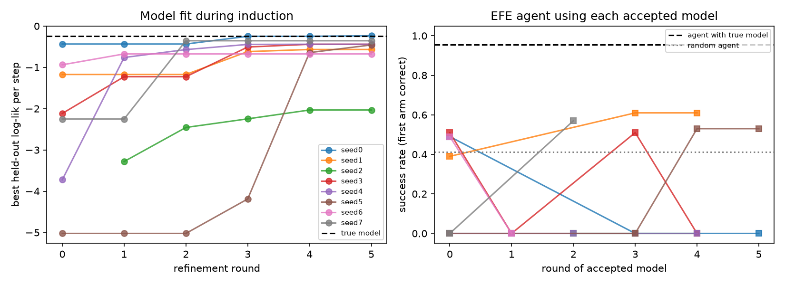

# aif-inductor

Can a language model work out the hidden rules of a world from raw sensor data, and can an agent then use those rules to act?

## Idea

A T-shaped maze has a reward in one arm and a penalty in the other. Which arm is good changes every episode. A cue at the bottom of the maze tells you which one it is.

The language model never sees any of this. It gets a log of numbers: three sensor readings per step and the move that was made. From that alone it has to write a model of the world as code.

Each proposed model is scored by how well it predicts data it has never seen. The language model gets back the moments its model found most surprising, revises, and tries again. Every revision is logged with the reason it gave, so the whole path from first guess to final model can be read afterwards.

The best model then drives a planning agent in the real maze. To do well, the model has to discover two things on its own: a hidden variable for which arm is good, and the fact that the cue reveals it.

## Background

This builds on recent work on learning world models with language models, in particular [Pinductor](https://github.com/atomresearch/pinductor) (Six, Panse, Fajeau, Da Costa et al., NeurIPS 2026), which learns models from observations only, without access to hidden states.

The setup here is smaller, which allows things a larger domain cannot:

- **Exact scoring.** The models are discrete POMDPs, so their likelihood is computed exactly with the forward algorithm, with no sampling and no hand-written distance measure.
- **Label-free evaluation.** The score depends only on what a model predicts, never on how it names or orders its hidden states.
- **Fit and behaviour measured separately.** Every model is scored on held-out data and also tested by an active inference agent that plans by expected free energy (pymdp).
- **A direct test of the key structure.** A separate check asks each model whether the cue changes its prediction of the reward, so a model gets credit for the right structure however it encodes it.

## Results

8 runs with a free model (Nemotron Ultra), 5 rounds of revision each, 30 training episodes.

| Run | Agent success | With the true rules | Model links cue to reward |
|---|---:|---:|---|
| 0 | 0.00 | 0.97 | no |
| 1 | 0.61 | 0.97 | yes |
| 2 | 0.00 | 0.94 | no |
| 3 | 0.00 | 0.96 | no |
| 4 | 0.00 | 0.95 | no |
| 5 | 0.53 | 0.96 | no |
| 6 | 0.00 | 0.95 | no |
| 7 | 0.57 | 0.95 | no |

Success is how often the agent's first arm was the rewarded one. With the true rules an agent gets 94 to 97%. With the language model's rules it averaged 21%.

Findings:

- **Better predictions did not mean better decisions.** In run 0 the language model found the cue rule on its first attempt. Later models predicted the data better but had lost the rule, and selection kept them. The final model came closest of all runs to the true model's score, and its agent never entered an arm.
- **Finding the structure is not enough.** Run 1 ended with a model that links the cue to the reward, yet its agent never went to read the cue.
- **Reading a model's code can mislead.** Run 4 looks linked from its structure but predicts no link at all. Checking predictions, not structure, was necessary.
- **Free models struggle with the format itself.** 12 of 48 revisions failed: malformed models, missing code, or crashes. Reasoning models ran out of tokens before answering, so reasoning had to be switched off.

Full tables, every revision with its stated reason, and the logs behind each number are in [results](results/seeds.md).



## Extension: how much data, and what kind?

Does the language model find the cue rule more often when the training data is more informative?

The sweep compares two kinds of demonstrations:

- **Random:** every move is random, so few episodes visit the cue and then an arm.
- **Cue first:** every episode visits the cue, then a random arm. The cue rule is in plain sight.

Each kind is tested with 5, 10, 20 and 40 training episodes, and every resulting model is scored by the cue-link check and by its agent's behaviour. Test data stays random throughout, so scores stay comparable. The sweep resumes where it stopped and checks the free request quota before each run.

Results will be added here once the first full sweep has run.

## Run it

Python 3.11.

```bash
python3.11 -m venv .venv && source .venv/bin/activate
pip install -r requirements.txt
python tests/test_basics.py && python tests/test_reliability.py && python tests/test_extension.py
```

Offline, with scripted replies and no API key:

```bash
python scripts/run.py --mock --rounds 3
python scripts/sweep.py --mock --out runs/mock_sweep
```

With a free model through OpenRouter (50 requests a day; one run uses 6):

```bash
export OPENROUTER_API_KEY=...
scripts/run_seeds.sh
python scripts/sweep.py --seed 0
python scripts/plot_sweep.py results/sweep_seed0.csv
```
